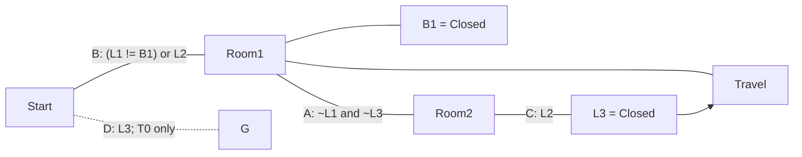

Toggles:

- L1 = Open (inaccessible)
- L2 = Closed (inaccessible)
- L3 = Closed
- B1 = Closed

Doors:

- A: ~L1 and ~L3
- B: (L1 != B1) or L2
- C: L2
- D: L3

Solution:

- Go through B (don't observe A or D)
- Photograph A as closed
- Travel to T-1
- Press B1 --> Forces L1 = Closed
- Go through A
- View photograph, learn A started Closed --> Forces L2 = Open (B1 and L1 are irreversible)
- Go through C
- Flip L3 = T (A closes again, matching observed start)
- Travel -> T0
- Go through D to Goal
- **Note**: in this timeline, the "truth" is that L1 started Closed and L2 started Open. B1 started Closed in T-1 and, because you opened it, Open in T0. All events, including the camera's observation, are consistent with that start state. Your only real action is to change the default start state under uncertainty.
